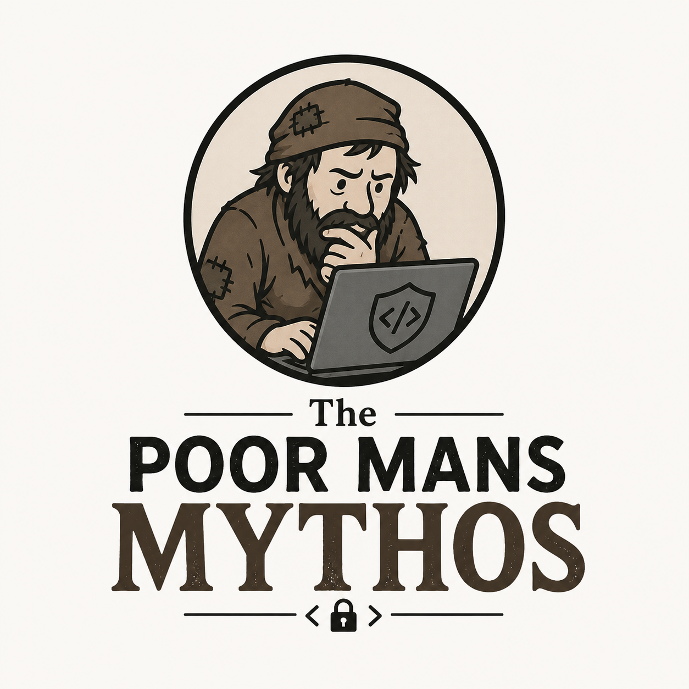

<p align="center">
  
</p>

# Poor Man's Mythos

[Claude Mythos](https://red.anthropic.com/2026/mythos-preview/) is Anthropic's restricted AI model built specifically for finding and exploiting security vulnerabilities. It's genuinely impressive — it has discovered zero-days in every major OS and browser, and compressed years of security auditing into weeks. Anthropic decided it was too dangerous for public access, so it's gated behind [Project Glasswing](https://www.anthropic.com/glasswing), an invite-only industry consortium for organizations maintaining critical software.

We are not one of those organizations.

So here's this instead: a Claude Code plugin that uses regular Claude to do a best-effort security audit of your repo. It won't find 27-year-old kernel bugs. But it will map your application's attack surface, classify every file by risk, run parallel reviewers across files and across attack scenarios, validate each finding against the actual code, and produce an explicit coverage statement so you know what *wasn't* checked. For most projects, that's probably enough.

## Installation

```
/plugin marketplace add hanskhe/poor-mans-mythos
/plugin install poor-mans-mythos@poor-mans-mythos
```

## Usage

```
Run a security audit on this repo
```

Claude runs a five-phase audit. What you read lands in `.security-audit/`: the report, a standalone `coverage.md`, the recon document (`recon.md`) and the file rankings (`file-rankings.md`). The working files the agents pass to each other (raw and merged findings, clusters, verdicts, TSVs) live in `.security-audit/work/` and are deleted when the audit ends. A `.gitignore` is auto-written so findings — which may quote real secrets verbatim from your code — never end up in commits.

## How it works

1. **Recon** — detects framework, auth model, entry points, outbound surface, and trust boundaries, and builds a route map (route → handler → guards applied) that every later agent starts from. Asks one or two threat-model questions to anchor severity. Output: `recon.md`.
2. **Classify** — a script sorts every file into review / skim / skip by path rules and a grep for risky primitives; Claude only decides the ambiguous ones. Files named in recon default to review. Output: `file-rankings.md`.
3. **Review** — two passes run in parallel:
   - **Per-file:** one agent per Review file. Each has Read/Grep/Bash and follows data flow across files.
   - **Scenario-driven:** one agent per attack class — injection, IDOR/BOLA, function-level authz, SSRF, auth/middleware ordering, crypto, deserialization, resource consumption, logging, and exception handling. Each agent grep-walks the whole repo asking the question an attacker would.
4. **Validate** — findings are deduplicated and clustered by script; one validator agent per cluster, in a fresh context, confirms or refutes each finding, marks duplicates, adjusts severity against a published rubric, and attaches a concrete fix.
5. **Coverage** — explicit statement of which scenarios ran, which OWASP categories were touched, which files were skipped, which pass (per-file or scenario) found each confirmed finding, and where confidence is low. The report is honest about its blind spots.

Findings carry severity (Critical/High/Medium/Low, rubric-anchored), CWE, OWASP category, a verbatim code excerpt, source provenance, a one-line data-flow trace, and a fix recommendation that names the function or symbol to change.

## Cost

This is a token-heavy multi-agent skill. As rough orders of magnitude from a v0.2 reference run: a scenario agent burned ~180K tokens, a per-file reviewer averaged ~50K, and a full audit on a 1,000-file repo with all ten scenarios and validation can reach **several million tokens**. Run `/model opus` before invoking for the best quality; the bill scales with the model you've selected.

v0.3 cuts the overhead around the review work without reducing the review itself:

- Agents write findings straight to files and reply with one line; a Python script (`scripts/audit.py`) merges, deduplicate, cluster and assemble the report. The orchestrator no longer re-types every finding four or five times (which also kept verbatim excerpts from drifting).
- Reviewers, scenario agents and validators are dedicated plugin agents (`agents/`): short spawn prompts, only Read/Grep/Glob/Bash/Write (no MCP tool definitions), per-agent effort levels, and turn caps.
- The route map built once in recon replaces each scenario agent re-deriving the routing and middleware chain.
- Agents are told to grep before reading and to read line ranges instead of whole files.

Every run records subagent token usage in the report, so costs can be compared across runs. Agents inherit your session model; change a model or effort level in the frontmatter of the files in `agents/`.

Requirements: [uv](https://docs.astral.sh/uv/), which installs the script's Python dependencies (pandas, Jinja2, PyYAML, pathspec, Typer) on first run.

## License

MIT
